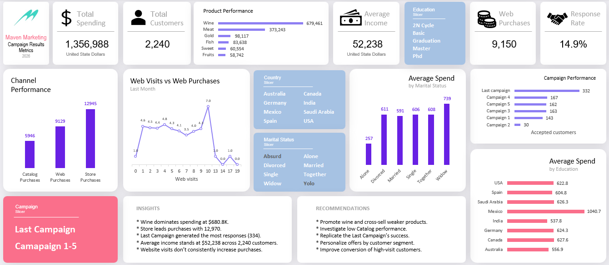

# Marketing Campaign Analysis Dashboard

## Project Overview

This project analyzes marketing campaign data from **2,240 customers of Maven Marketing** to understand customer behavior, product performance, campaign effectiveness, and purchasing channels.

The analysis was designed to answer key business questions and present the findings through an interactive Excel dashboard.

## Business Questions

The analysis focused on:

* Which factors are associated with the number of web purchases?
* Which marketing campaign was the most successful?
* What does the average customer profile look like?
* Which products generate the most customer spending?
* Which purchasing channels perform best?
* Which channels or campaigns may be underperforming?
* How do customer demographics relate to spending and campaign response?

## Tools & Techniques

* **Microsoft Excel**
* PivotTables
* Power Query
* XLOOKUP/VLOOKUP
* IF statements
* Calculated fields
* Charts and KPI cards
* Interactive slicers
* Data cleaning and transformation

## Dashboard

The interactive dashboard provides an overview of:

* Customer and spending KPIs
* Product performance
* Channel performance
* Campaign performance
* Customer profile and average spending
* Web visits versus web purchases
* Country performance
* Campaign response
* Customer segmentation by education and marital status

### Dashboard Preview

## Key Analysis

### Product Performance

Analyzed customer spending across different product categories to identify products generating the highest and lowest levels of customer expenditure.

### Channel Performance

Compared purchasing activity across web, catalog, and store channels to understand customer purchasing preferences.

### Campaign Performance

Evaluated campaign responses to identify successful campaigns and areas where marketing performance could be improved.

### Customer Profile

Analyzed customer characteristics and spending patterns across demographic groups, including education and marital status.

### Web Purchase Behavior

Examined the relationship between monthly web visits and web purchases to identify factors associated with online purchasing activity.

### Geographic Performance

Used country-level analysis to compare customer activity and performance across different markets.

## Recommendations

* Focus marketing efforts on products and channels showing stronger customer engagement.
* Investigate factors associated with higher web purchasing activity to improve digital marketing performance.
* Use customer segmentation to create more targeted campaigns.
* Review underperforming campaigns and channels to identify opportunities for improvement.
* Use customer and geographic insights to support more informed marketing decisions.

## Project Outcome

The project demonstrates the use of Excel to transform customer marketing data into an interactive, business-focused dashboard. It combines data preparation, exploratory analysis, PivotTables, visualization, and interactive filtering to communicate actionable insights.
